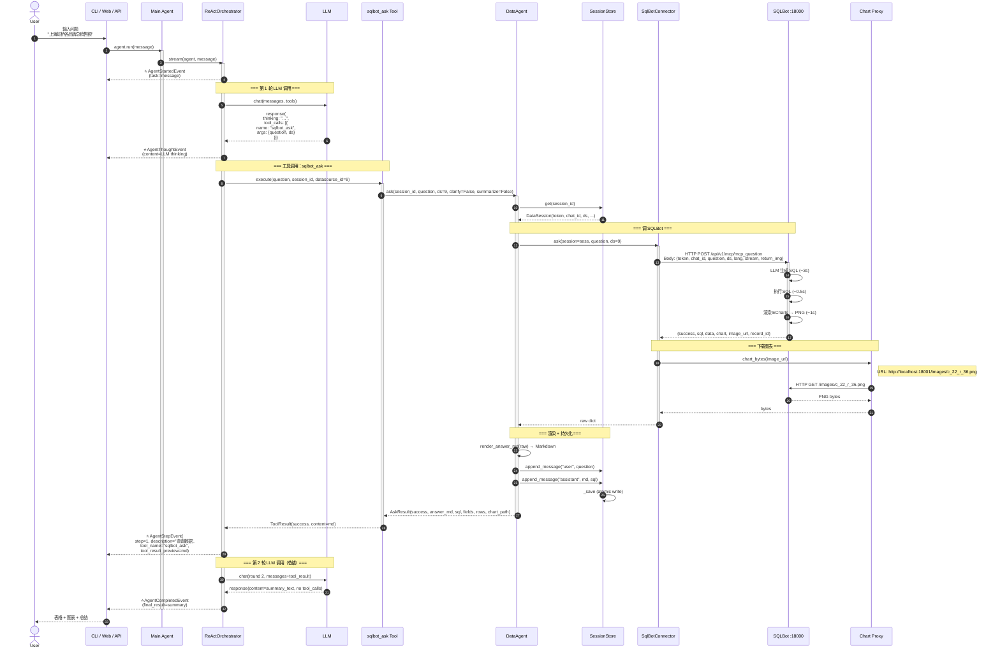

# Mini-Agent 流程时序图

> **v3.4 实际实施版本**的流程时序图。
> 配套文档：`AGENT_PLATFORM_V3.1.md`（主架构）、`EXTENDING.md`（如何扩展）

## 一、问数 (data_query) 流程（Skills + MCP 集成）

### 1.1 高层流程

```
用户: "上海虹桥各品牌总销售额"
  ↓
[1]  User → UI (CLI / Web / API)
[2]  UI → Main Agent: agent.run(message)
[3]  Agent → Plugins: 聚合所有 tools（含 run_skill）
[4]  ReAct Orchestrator → LLM: chat(messages, all_tools)
[5]  LLM → ReAct: tool_calls=[{name: "run_skill", args: {skill_name, input}}]
[6]  ReAct → run_skill Tool: execute(skill_name="data_query", input=...)
[7]  run_skill → 返回 SKILL.md 指令（data_query skill 全文）
[8]  LLM 按 SKILL.md 指令，调用 SqlBot Connector（直接 HTTP）
[9]  SqlBot: LLM 生成 SQL + 执行 + 渲染图表
[10] SQLBot → Connector: {sql, data, chart, image_url}
[11] Connector → SQLBot /images: GET PNG（下载图表）
[12] DataAgent: render_answer_md → Markdown
[13] DataAgent → SessionStore: append_message + save
[14] DataAgent → Tool: AskResult（success + answer_md）
[15] Tool → ReAct: ToolResult(answer_md)
[16] ReAct → LLM: chat（round 2，可选总结）
[17] LLM → ReAct: 总结文本
[18] ReAct → UI: AgentCompletedEvent
[19] UI → User: 表格 + 图表
```

### 1.2 时序图



### 1.3 事件时间线

```
T+0.0s  AgentStartedEvent        (task="上海虹桥...")
T+1.2s  AgentThoughtEvent       (LLM 思考)
T+1.4s  AgentStepEvent #1      (tool_name=sqlbot_ask, tool_args={...})
        ↓ SQLBot 内部 (3-5s)
T+5.8s  AgentStepEvent #1      (tool_result_preview=md)
T+6.0s  AgentCompletedEvent     (final_result=summary)
```

### 1.4 关键决策点

| 决策 | 理由 |
|------|------|
| 单步问题用 Skill | 避免 SubAgent 多余的 LLM 调用（节省 1-2s）|
| LLM 直接选 tool | 简单问题无需 orchestrator 介入 |
| chart 走代理而非直连 | SQLBot 在 Docker 内网，API 代理隐藏实现 |
| datasource_id 默认 None → session 默认 | 灵活支持显式选择 + 默认行为 |

---

## 二、数据分析报告 (data_analysis_report) 流程

### 2.1 高层流程

```
用户: "分析本月销售下滑原因"
  ↓
[1] User → Main Agent: agent.run(message)
[2] Main Agent LLM: 决定调 ask_data_analysis_report tool
[3] ask_data_analysis_report Tool → SubAgent.run(question)
[4] SubAgent: 可选 Clarify → Plan → Execute → Synthesize
[5] PlanExecute Orchestrator: plan 4 步
[6] 串行执行: sqlbot_ask × 3 → file_write × 1
[7] LLM Synthesize: 综合所有 observation → Markdown 报告
[8] 报告保存到 workspace/reports/{timestamp}.md
[9] 报告返回到 Main Agent → LLM 总结 → 用户
[10] UI 显示带 citation 的报告（实时步骤展开）
```

### 2.2 时序图

```mermaid
sequenceDiagram
    autonumber
    actor U as User
    participant W as Web UI
    participant MA as Main Agent
    participant MR as ReAct Orchestrator<br/>(Main)
    participant ML as Main LLM
    participant T as ask_data_analysis_report<br/>Tool (wraps SubAgent)
    participant SA as DataAnalysisReportSubAgent
    participant PE as PlanExecute Orchestrator<br/>(Sub)
    participant SL as Sub LLM
    participant DA as DataAgent
    participant SB as SQLBot
    participant FS as File System

    U->>W: "分析本月销售下滑原因"
    W->>MA: agent.run(message)
    activate MA
    MA->>MR: stream(agent, message)
    activate MR
    MR-->>W: ⭐ AgentStartedEvent(source=main)

    Note over MR,ML: === Main LLM 决定用 sub-agent ===
    MR->>ML: chat(messages, tools)
    ML-->>MR: tool_calls=[{<br/>  name: "ask_data_analysis_report",<br/>  args: {question, focus: ""}<br/>}]
    MR-->>W: ⭐ AgentThoughtEvent

    Note over MR,T: === 调 sub-agent tool ===
    MR->>T: execute(question, focus)
    activate T
    T->>SA: run(question, focus)
    activate SA
    PE-->>W: ⭐ AgentStartedEvent(<br/>  source="data_analysis_report",<br/>  task=question)

    Note over PE,SL: === 阶段 1: Clarify (可选) ===
    alt 问题需要澄清
        PE->>SL: generate_clarifying_questions(question)
        SL-->>PE: ["关注哪个维度?", "时间范围?"]
        PE-->>W: ⭐ AgentClarificationEvent(<br/>  source="data_analysis_report",<br/>  questions=[...])
        W->>U: 💬 显示澄清问题
        U->>W: 回答: "区域维度, 本月"
        W->>PE: stream(question, focus=answers)
    else 问题清晰
        Note over PE: 跳过 Clarify
    end

    Note over PE,SL: === 阶段 2: Plan ===
    PE->>SL: plan(question, available_tools, format=PlanSchema)
    SL-->>PE: Plan(steps=[<br/>  {tool: "sqlbot_ask", reason: "查本月总销售", optional: false},<br/>  {tool: "sqlbot_ask", reason: "查去年同期对比", optional: false},<br/>  {tool: "sqlbot_ask", reason: "查品类分布", optional: true},<br/>  {tool: "file_write", reason: "保存报告", optional: false}<br/>])
    PE-->>W: ⭐ AgentStepEvent(<br/>  source="data_analysis_report",<br/>  step=0, description="计划: 4 步")

    Note over PE,FS: === 阶段 3: Execute (串行) ===
    
    rect rgb(240, 248, 255)
        Note over PE,SB: Step 1: 查本月总销售
        PE->>DA: ask(question, ds=9)
        DA->>SB: HTTP /mcp_question
        SB-->>DA: {data, sql}
        DA-->>PE: AskResult
        PE-->>W: ⭐ AgentStepEvent(<br/>  step=1, tool_name="sqlbot_ask",<br/>  tool_result_preview=...)
    end
    
    rect rgb(240, 248, 255)
        Note over PE,SB: Step 2: 查去年同期对比
        PE->>DA: ask(question, ds=9)
        DA->>SB: HTTP /mcp_question
        SB-->>DA: {data, sql}
        DA-->>PE: AskResult
        PE-->>W: ⭐ AgentStepEvent(<br/>  step=2, tool_name="sqlbot_ask",<br/>  tool_result_preview=...)
    end
    
    rect rgb(240, 248, 255)
        Note over PE,SB: Step 3 (optional): 查品类分布
        PE->>DA: ask(question, ds=9)
        DA->>SB: HTTP /mcp_question
        SB-->>DA: {data, sql}
        DA-->>PE: AskResult
        PE-->>W: ⭐ AgentStepEvent(<br/>  step=3, tool_name="sqlbot_ask",<br/>  tool_result_preview=...)
    end
    
    rect rgb(255, 248, 240)
        Note over PE,FS: Step 4: 保存报告
        PE->>FS: write(workspace/reports/2026-07-25_120000.md, content=...)
        FS-->>PE: path
        PE-->>W: ⭐ AgentStepEvent(<br/>  step=4, tool_name="file_write",<br/>  tool_result_preview="报告已保存: ...")
    end

    Note over PE,SL: === 阶段 4: Synthesize ===
    PE->>SL: synthesize(<br/>  task=question,<br/>  plan=plan,<br/>  observations=[step1..4],<br/>  format=ReportTemplate
    )
    SL-->>PE: report_markdown
    PE-->>W: ⭐ AgentCompletedEvent(<br/>  source="data_analysis_report",<br/>  final_result=report_markdown)
    deactivate PE
    deactivate SA
    SA-->>T: report
    deactivate T
    
    T-->>MR: ToolResult(<br/>  success, content=report)
    MR-->>W: ⭐ AgentStepEvent(<br/>  step=1, source="data_analysis_report",<br/>  tool_name="ask_data_analysis_report",<br/>  tool_result_preview=report[:200])

    Note over MR,ML: === Main LLM 总结 ===
    MR->>ML: chat(messages+report, no tool)
    ML-->>MR: response(content=summary)
    MR-->>W: ⭐ AgentCompletedEvent(final_result=summary)
    deactivate MR
    deactivate MA
    W-->>U: 📄 报告（带展开的步骤、citation、图表）
```

### 2.3 事件时间线

```
T+0.0s   AgentStartedEvent            (source=main)
T+1.0s   AgentThoughtEvent
T+1.2s   AgentStepEvent #1           (tool=ask_data_analysis_report)

# ⭐ Sub-agent 事件（source=data_analysis_report）
T+1.3s   AgentStartedEvent            (source=data_analysis_report, task="...")
T+2.0s   AgentClarificationEvent     (questions=["维度?", "时间?"])  [可选]
T+15s     AgentStepEvent #0           (description="计划: 4 步")
T+18s     AgentStepEvent #1           (step=1, tool=sqlbot_ask, preview="...")
T+22s     AgentStepEvent #1           (step=1, result="...")
T+22.5s   AgentStepEvent #2           (tool=sqlbot_ask)
T+27s     AgentStepEvent #2           (result="...")
T+27.5s   AgentStepEvent #3           (tool=sqlbot_ask)
T+32s     AgentStepEvent #3           (result="...")
T+32.5s   AgentStepEvent #4           (tool=file_write)
T+33s     AgentStepEvent #4           (result="报告已保存")
T+40s     AgentCompletedEvent        (source=data_analysis_report, final_result=报告)

# 回到 main agent
T+40.5s   AgentStepEvent #1           (source=data_analysis_report, tool=ask_data_analysis_report)
T+43s     AgentCompletedEvent        (final_result=总结)
```

### 2.4 报告模板（OpenAI DR 风格）

```markdown
# {title}

## 摘要
{3-5 句核心结论}

## 关键发现
1. **{finding_1}** [SQL #1, 数据范围: 2024-01~2024-06]
2. **{finding_2}** [SQL #2, 数据范围: 2024-01~2024-06]
3. **{finding_3}** [SQL #3]

## 数据支撑
### 1.1 {section_title}
- 结论：{claim}
- 数据：{data_preview}
- 图表：
- SQL: `SELECT ...`

## 建议
1. {actionable_recommendation_1}
2. {actionable_recommendation_2}

## 方法论
- 数据源：商铺日销售数据
- 时间范围：2024-07-01 至 2024-07-25
- 分析模型：Mini-Agent PlanExecute
- 生成时间：2026-07-25 12:05
```

### 2.5 关键决策点

| 决策 | 理由 |
|------|------|
| 可选 Clarify | 避免打扰用户；focus 已填则跳过 |
| Plan 用 LLM | 灵活适应不同任务 |
| 步骤可标记 optional | 单步失败不阻塞整体 |
| 串行执行 | 数据查询有顺序依赖（先有"本月"，才能"对比"）|
| 报告带 Citation | 用户可追溯每个 claim 的 SQL 来源 |
| 报告保存到文件 | 长期留存，可二次访问 |

---

## 三、对比与权衡

| 维度 | 问数 | 数据分析报告 |
|------|------|-------------|
| **抽象层级** | Skill（Tool） | SubAgent（独立 Orchestrator）|
| **Orchestrator** | Main ReAct | Sub PlanExecute |
| **LLM 调用次数** | 2（main + 总结）| 2-5（clarify + plan + execute × N + synthesize）|
| **典型耗时** | 4-7s | 30-60s |
| **典型输出长度** | 1-2 屏 | 1-3 页 Markdown |
| **状态复杂度** | 低（单 session）| 中（plan + observations）|
| **失败模式** | 单点失败（ask 失败）| 部分失败（step 失败可 optional 跳过）|
| **Citation** | SQL | SQL + 数据范围 + 章节引用 |

### 与 OpenAI Deep Research 对比

| 维度 | 问数 | 数据分析报告 | OpenAI DR |
|------|------|-------------|-----------|
| 目标 | 单步查 | 多步分析 | 通用研究 |
| Sub-agents | 0 | 1 | N（并行）|
| Clarify | 可选 | 可选 | 必须 |
| Citation | SQL | SQL + range | URL |
| 异步并发 | ❌ | ❌ | ✅ |
| 长报告 | ❌ | ✅ | ✅ |
| 实时 UI | ✅（阶段 D）| ✅ | ✅ |

---

## 四、关键代码位置

| 流程 | 涉及文件 |
|------|---------|
| 问数 | `mini_agent/agent.py`<br>`mini_agent/core/orchestrator.py`<br>`skills/data_query/SKILL.md`<br>`skills/data_query/scripts/ask.py`<br>`mini_agent/connectors/sqlbot.py`<br>`mini_agent/render.py`<br>`mini_agent/memory/session.py` |

---

## 五、Edge Cases 处理

### 5.1 数据源切换（多轮）

```
# Round 1: 问销售
session 1: ds=9 (sales)
T+0  [started]
T+5  [completed] 销售数据

# Round 2: 问客流（同 session，ds 不同）
T+10 [started]
T+11 [step] tool_args.datasource_id = 11
       # ⚠️ SQLBot 多轮上下文会"粘"ds=9

# v3.1 修复：检测到 ds 变化时自动新建 session
# 实际机制（v3.1 在 sqlbot_ask Tool 中）：
async def execute(self, question, session_id, datasource_id=None):
    sess = self._agent.store.get(session_id)
    if datasource_id and datasource_id != sess.default_datasource_id:
        # 切 ds → 新 session
        new_sess = self._agent.store.create(default_datasource_id=datasource_id)
        return await self._agent.ask(new_sess.id, question, datasource_id=datasource_id)
```

### 5.2 LLM 不可达

```
T+0   [started]
T+30  [error] error="LLM ConnectionError"
      # ReAct 立即终止，返回 ErrorEvent
      # 提示用户：检查 API key / 网络
```

### 5.3 Sub-agent 单步失败

```
Plan: 4 步
Step 3 (optional) 失败
→ PE 继续 Step 4
→ Synthesize 时只基于 step 1,2,4 的 observations
→ 报告中标注"部分数据缺失"
```

### 5.4 Sub-agent 总超时

```
T+0:00  plan
T+0:05  step 1
T+2:00  step 2 (slow)
T+5:00  ← asyncio.TimeoutError (300s)
       AgentErrorEvent(error="总超时")
```

---

## 六、前端事件渲染示例

```typescript
// Web UI: 嵌套显示主 agent + sub-agent 事件
function AgentEventList({ events }: Props) {
  return (
    <div>
      {events.map(ev => {
        if (ev.source === 'data_analysis_report') {
          return <SubAgentCard source="data_analysis_report" event={ev} />;
        }
        return <MainAgentEvent event={ev} />;
      })}
    </div>
  );
}

function SubAgentCard({ event }) {
  return (
    <div className="sub-agent-card">
      <div className="header">📊 数据分析报告 sub-agent</div>
      {/* 嵌套显示 sub-agent 内部的步骤 */}
    </div>
  );
}
```

UI 效果：
```
┌────────────────────────────────────────────┐
│ 🧠 思考                                    │
│ 用户问的是销售下滑原因，需要 plan-execute   │
│                                            │
│ 🔧 工具调用                                │
│ ✓ ask_data_analysis_report                  │
│   ┌──────────────────────────────────────┐ │
│   │ 📊 数据分析报告 sub-agent              │ │
│   │                                        │ │
│   │ ✓ 已规划 4 步                          │ │
│   │ ✓ 步骤 1: 查本月总销售 (8s)         │ │
│   │   └─ SQL: SELECT SUM(...) ...         │ │
│   │ ✓ 步骤 2: 查去年同期对比 (7s)        │ │
│   │   └─ 数据: ¥1.2M, 同比 -23%          │ │
│   │ ⏳ 步骤 3: 查品类分布 (执行中...)     │ │
│   └──────────────────────────────────────┘ │
└────────────────────────────────────────────┘
```

---

## 七、参考

- `AGENT_PLATFORM_V3.1.md` - 完整设计
- `EXTENDING.md` - 如何扩展（Tool / MCP / Skill）
- `AGENT_FLOWS.md` - 本文档（时序图）

---

> **下一步**：确认设计后进入 **阶段 A** 实施（核心抽象，约 4-5 天）。